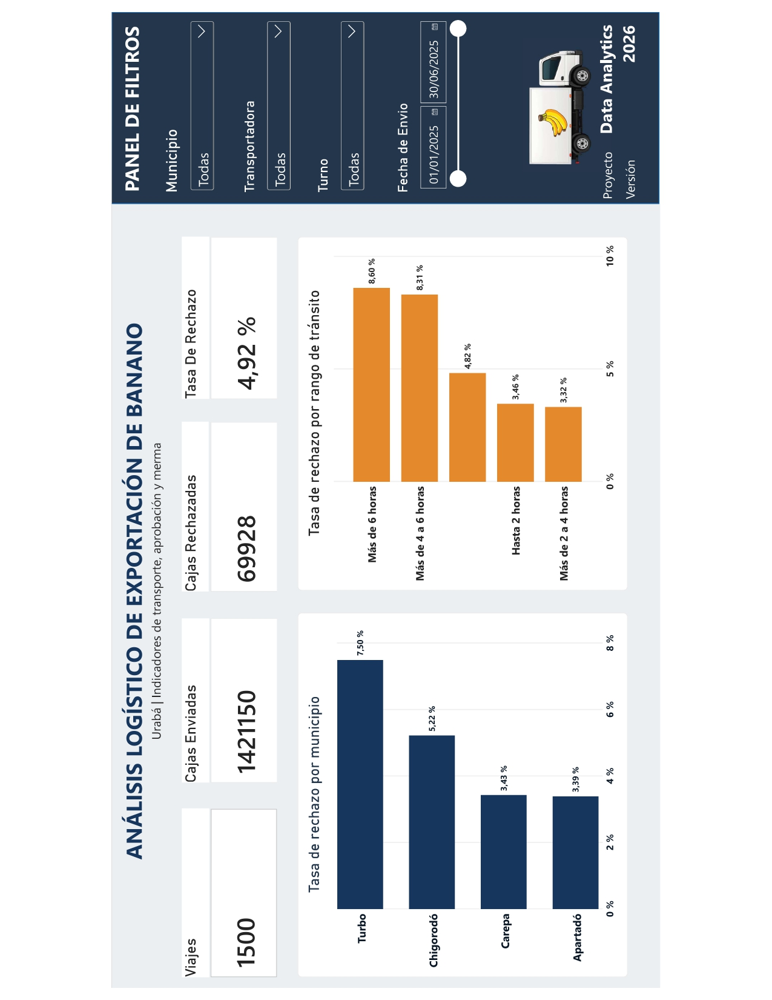
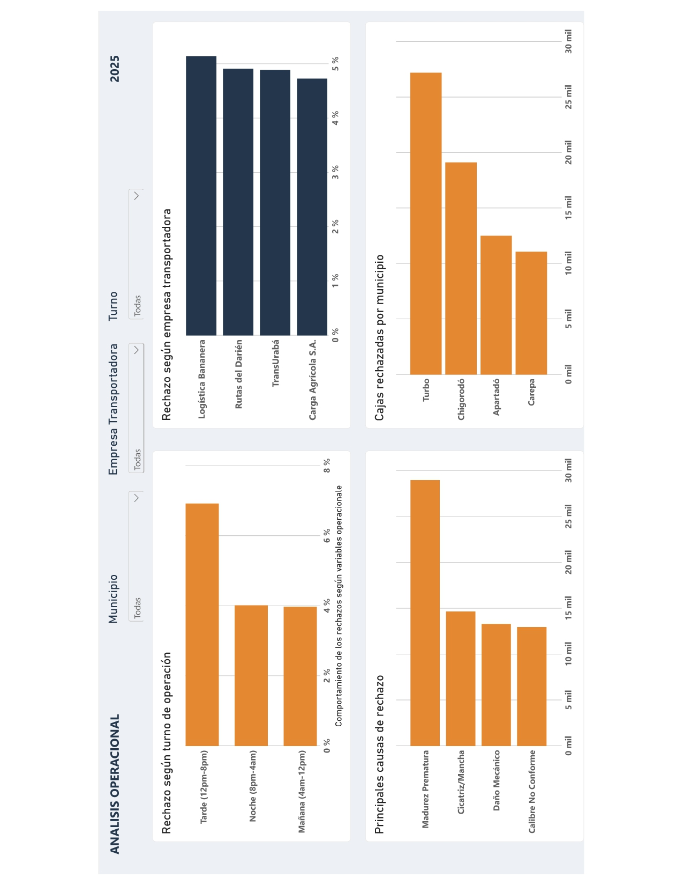
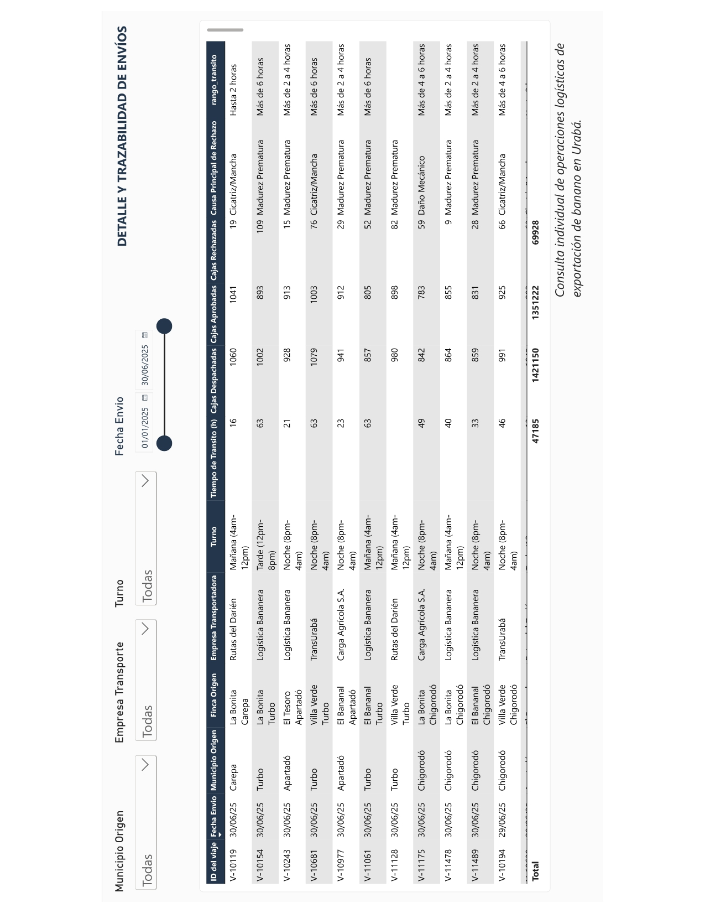

# Análisis logístico y reducción de merma en la exportación de banano

## Descripción del proyecto

Proyecto de análisis de datos enfocado en explorar el comportamiento de las operaciones logísticas relacionadas con el transporte de banano desde diferentes municipios y fincas de Urabá.

El propósito es analizar información sobre los viajes, las cajas transportadas, las cajas aprobadas y rechazadas, los tiempos de tránsito y los factores asociados al rechazo de la mercancía.

A través de la preparación de datos y la construcción de un dashboard interactivo en Power BI, se busca identificar patrones operativos, visualizar indicadores clave y facilitar la interpretación de la información logística.

> **Nota:** Este proyecto utiliza datos sintéticos con fines académicos y de portafolio. Los resultados no representan cifras reales de una empresa ni deben interpretarse como evidencia del comportamiento de la industria bananera.

---

## Objetivos

- Analizar el comportamiento de los viajes y las operaciones de transporte.
- Medir la proporción de cajas aprobadas y rechazadas.
- Explorar la relación entre los tiempos de tránsito y los niveles de rechazo.
- Comparar el comportamiento de las operaciones según municipio, turno y empresa transportadora.
- Identificar los principales motivos de rechazo.
- Construir un dashboard que facilite la consulta y el análisis de los indicadores logísticos.

---

## Tecnologías y herramientas

- **Microsoft Power BI:** construcción del dashboard, visualización e interacción con los datos.
- **Power Query:** revisión, limpieza y transformación de los datos.
- **DAX:** creación de medidas e indicadores para el análisis.
- **CSV:** fuente de datos utilizada en el proyecto.
- **Git y GitHub:** control de versiones y documentación del proyecto.

---

## Metodología

El desarrollo del proyecto se organizó en las siguientes etapas:

1. **Exploración de datos:** revisión de la estructura, los campos y los registros disponibles.
2. **Preparación y limpieza:** identificación de valores faltantes y revisión de la calidad de los datos mediante Power Query.
3. **Modelado y medidas:** creación de indicadores para calcular viajes, cajas transportadas, cajas rechazadas y tasa de rechazo.
4. **Análisis exploratorio:** comparación de resultados por municipio, turno, empresa transportadora, motivo de rechazo y rango de tránsito.
5. **Visualización:** diseño de un dashboard interactivo en Power BI dividido en tres páginas.

---

## Indicadores principales

| Indicador | Resultado |
|---|---:|
| Total de viajes | 1.500 |
| Cajas enviadas | 1.421.150 |
| Cajas aprobadas | 1.351.222 |
| Cajas rechazadas | 69.928 |
| Tasa general de rechazo | 4,92 % |

---

## Dashboard de Power BI

El informe está organizado en tres páginas para facilitar el análisis desde una perspectiva general hasta el detalle de cada operación.

### 1. Resumen ejecutivo

Presenta los principales indicadores logísticos y permite observar el comportamiento general de los envíos, la tasa de rechazo por municipio y los resultados según el rango de tiempo de tránsito.



### 2. Análisis operacional

Permite profundizar en el comportamiento de las operaciones mediante comparaciones por turno, empresa transportadora, motivo de rechazo y municipio de origen.



### 3. Detalle y trazabilidad de envíos

Incluye una tabla de consulta individual de los viajes, con información sobre fechas, municipios, fincas, empresas transportadoras, tiempos de tránsito, cantidades enviadas y motivos de rechazo.

Cuenta con filtros para facilitar la búsqueda y segmentación de las operaciones.



---

## Hallazgos del análisis exploratorio

A partir de los datos analizados se identificaron los siguientes patrones:

### 1. Comportamiento general del rechazo

De las 1.421.150 cajas enviadas, 69.928 fueron rechazadas, lo que representa una tasa general de rechazo del 4,92 %.

Este indicador permite establecer una referencia general para comparar los diferentes segmentos de las operaciones.

### 2. Tiempo de tránsito y tasa de rechazo

Se observó una diferencia en las tasas de rechazo según el rango de tiempo de tránsito:

| Rango de tránsito | Tasa de rechazo |
|---|---:|
| Hasta 2 horas | 3,46 % |
| Más de 2 a 4 horas | 3,32 % |
| Más de 4 a 6 horas | 8,31 % |
| Más de 6 horas | 8,60 % |

Los registros con tiempos de tránsito superiores a cuatro horas presentan tasas de rechazo más elevadas dentro del conjunto analizado.

Este patrón representa una asociación observada en los datos sintéticos y no demuestra una relación causal.

### 3. Calidad y completitud de los datos

Durante la revisión se identificaron 45 registros sin información en el campo `horas_transito`, equivalentes al 3 % del conjunto de datos.

Al comparar los registros:

- Registros con tiempo de tránsito disponible: tasa de rechazo del 4,92 %.
- Registros sin tiempo de tránsito disponible: tasa de rechazo del 4,82 %.

La diferencia es pequeña en este conjunto, pero evidencia la importancia de revisar la completitud de los campos antes de realizar análisis por tiempo de tránsito.

Los valores faltantes se conservaron como nulos y no se reemplazaron por cero.

### 4. Comparación de variables operativas

El dashboard permite explorar las diferencias en los rechazos según municipio de origen, turno operativo, empresa transportadora y motivo principal de rechazo.

Estas dimensiones facilitan la identificación de segmentos que merecen una revisión más detallada, sin asumir que una variable sea por sí sola la causa de los rechazos.

---

## Estructura del proyecto

```text
analisis-logistica-banano/
│
├── images/
│   ├── dashboard-detalle.jpg
│   ├── dashboard-operacional.jpg
│   └── dashboard-resumen.jpg
│
├── Dashboard.pbix
├── generador_datos.py
├── limpieza_datos.ipynb
├── logistica_banano_uraba.csv
├── logistica_limpia.csv
└── README.md
```

---

## Conclusiones

El ejercicio permitió construir un proceso de análisis que parte de la preparación de datos y termina en una herramienta de visualización interactiva.

Entre los resultados más relevantes se encuentra la identificación de diferencias en las tasas de rechazo según los rangos de tránsito, así como la detección de registros con información faltante.

El proyecto demuestra la aplicación de herramientas de análisis y visualización para transformar datos tabulares en indicadores y elementos de consulta que facilitan la interpretación de procesos logísticos.

---

## Mejoras futuras

- Incorporar nuevos indicadores de eficiencia logística.
- Profundizar en el análisis de las diferencias entre municipios y empresas transportadoras.
- Desarrollar consultas SQL para complementar el proceso de análisis.
- Automatizar la actualización y preparación de los datos.
- Ampliar el análisis con información real y validada del sector logístico, cuando esté disponible.

---

## Autor

**Juan David Durango Giraldo**

Ingeniería de Sistemas | Análisis de Datos | Business Intelligence

- GitHub: [@D4veDurango](https://github.com/D4veDurango)
